<p align="center">
  
</p>

# ComplexHeatmap-py

Complete standalone Python port of the R/Bioconductor **ComplexHeatmap** (v2.25.3) package, powered by NumPy, SciPy, Pandas, Pillow, and Matplotlib.

## Documentation

Full documentation and chapter-by-chapter tutorial book: **[ComplexHeatmap-py Complete Reference Book](https://zhanxw.github.io/ComplexHeatmap-reference-py/book/)**

## Installation

```bash
pip install ComplexHeatmap-py
```

Or install from source:

```bash
git clone https://github.com/zhanxw/ComplexHeatmap-py.git
cd ComplexHeatmap-py
pip install -e .
```

Both `import complexheatmap as ch` and `import ComplexHeatmap as ch` are supported.

## Quick Example

```python
import matplotlib
matplotlib.use("Agg")
import numpy as np
import pandas as pd
import complexheatmap as ch

ch.ht_opt(kmeans_seed=123)
rng = np.random.default_rng(123)
mat = pd.DataFrame(
    rng.standard_normal((12, 10)),
    index=[f"gene_{i}" for i in range(12)],
    columns=[f"sample_{j}" for j in range(10)],
)

ha_top = ch.HeatmapAnnotation(
    Group=["Ctrl"] * 5 + ["Treat"] * 5,
    Score=ch.anno_barplot(rng.uniform(0, 1, 10)),
    col={"Group": {"Ctrl": "#4DAF4A", "Treat": "#E41A1C"}},
)

ht1 = ch.Heatmap(mat, name="Expr", row_km=2, top_annotation=ha_top, border=True)
ht2 = ch.Heatmap(mat.iloc[:, :4] * 2, name="Delta")
res = ch.draw(ht1 + ht2, width=9.0, height=6.5, dpi=150)

# Post-draw decoration (just like R's decorate_heatmap_body)
with ch.decorate_heatmap_body("Expr", row_slice=1, column_slice=1):
    ch.grid.rect(gp=ch.gpar(fill="transparent", col="gold", lwd=2))

res._device.fig.savefig("heatmap.png", dpi=150, facecolor="white")
```

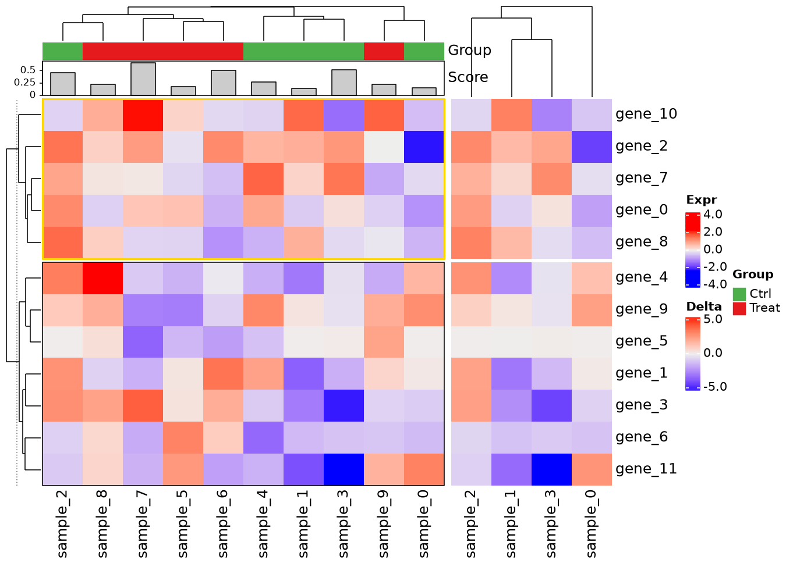

## R ComplexHeatmap Flagship Examples (Replicated in Python)

The 6 flagship showcase examples from the upstream [jokergoo/ComplexHeatmap](https://github.com/jokergoo/ComplexHeatmap) README are replicated in Python in [`examples/r_readme_examples.py`](https://github.com/zhanxw/ComplexHeatmap-py/blob/main/examples/r_readme_examples.py):

### 1. Visualize Methylation Profile with Complex Annotations

```python
ht_meth = ch.Heatmap(
    mat_meth, name="Methylation",
    col=ch.colorRamp2([0.0, 0.5, 1.0], ["#2166AC", "#F7F7F7", "#B2182B"]),
    column_split=pd.Categorical(dkfz_subtype, categories=subtypes, ordered=True),
    column_title="%s", top_annotation=ha_clinical, use_raster=True, border=True,
)
ht_expr = ch.Heatmap(
    mat_expr, name="Expression",
    col=ch.colorRamp2([-2.0, 0.0, 2.0], ["#1B7837", "#F7F7F7", "#762A83"]),
    use_raster=True, border=True,
)
ch.draw(ht_meth / ht_expr, merge_legends=True)
```

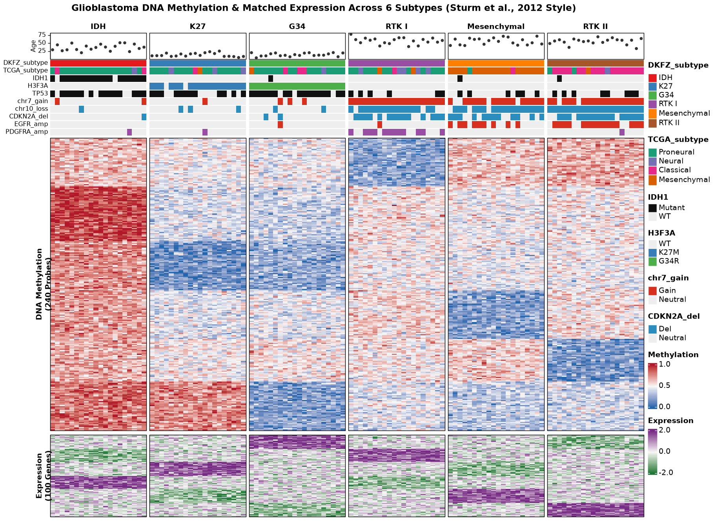

### 2. Correlations Between Methylation, Expression and Other Genomic Features

```python
ds = ch.load_dataset("meth")
hl = ht_dir + ht_meth + ht_expr + ht_p + ht_gtype + ht_anno + ra_dist + ht_enh
ch.draw(hl, main_heatmap="Methylation", merge_legends=True)
```

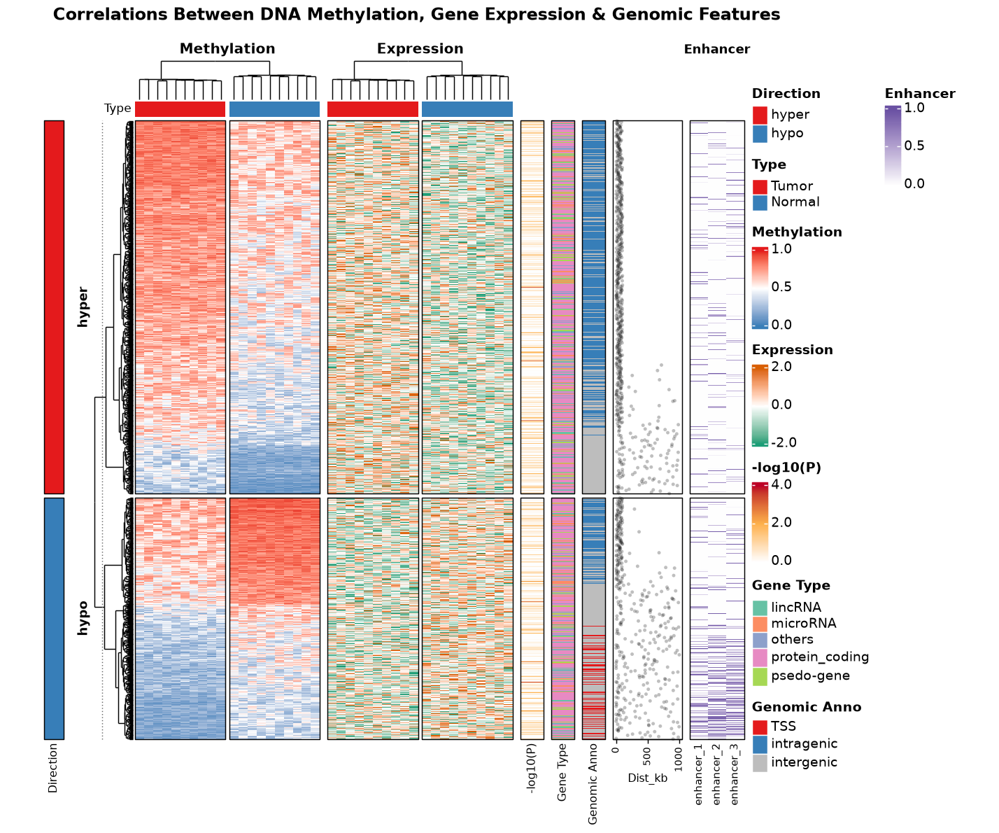

### 3. Visualize Cell Heterogeneity from Single-Cell RNA-Seq

```python
hl = ht_expr + ht_base + ht_rnp + ht_cc + ht_corr + ch.rowAnnotation(
    mark=ch.anno_mark(at=marker_idx, labels=marker_names, link_width=ch.unit(6, "mm")),
)
ch.draw(hl, main_heatmap="Scaled Expr", merge_legends=True)
```

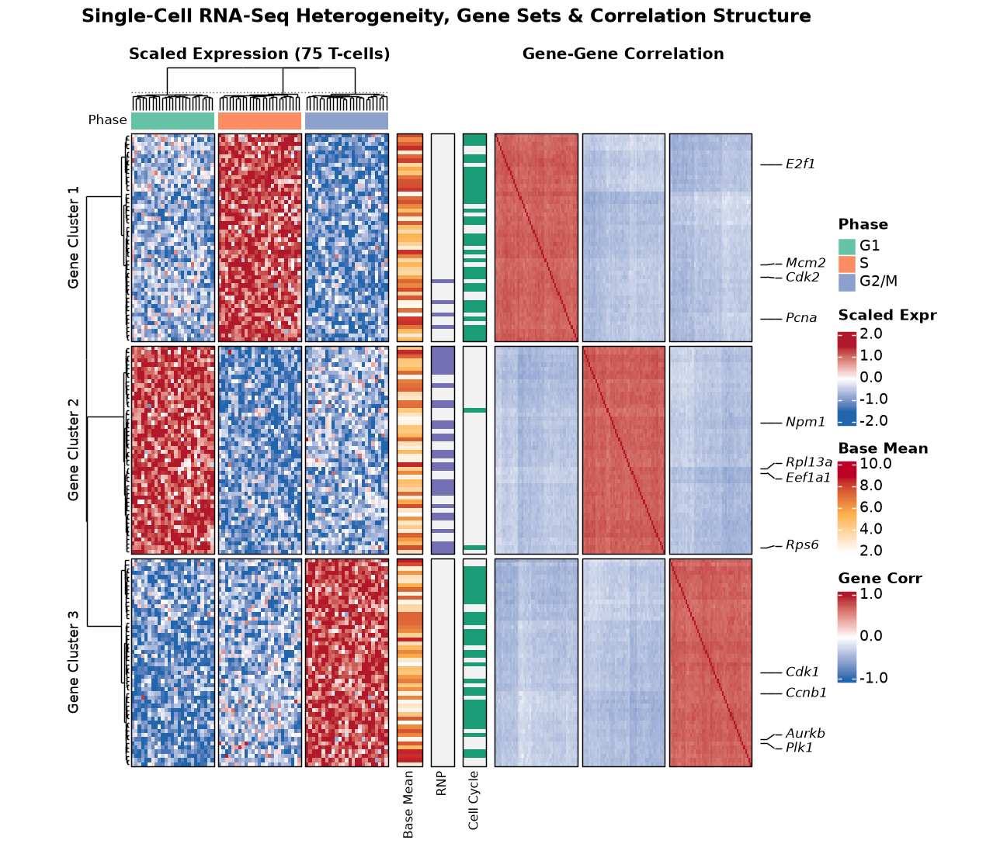

### 4. Making Enhanced OncoPrint

```python
op = ch.oncoPrint(
    ch.load_dataset("tcga_lung_adenocarcinoma"),
    alter_fun=alter_fun, col=alt_col,
    top_annotation=ha_top, right_annotation=ha_right,
    remove_empty_columns=True, remove_empty_rows=True,
)
ch.draw(op + ht_pathway, main_heatmap=op.name, merge_legends=True)
```

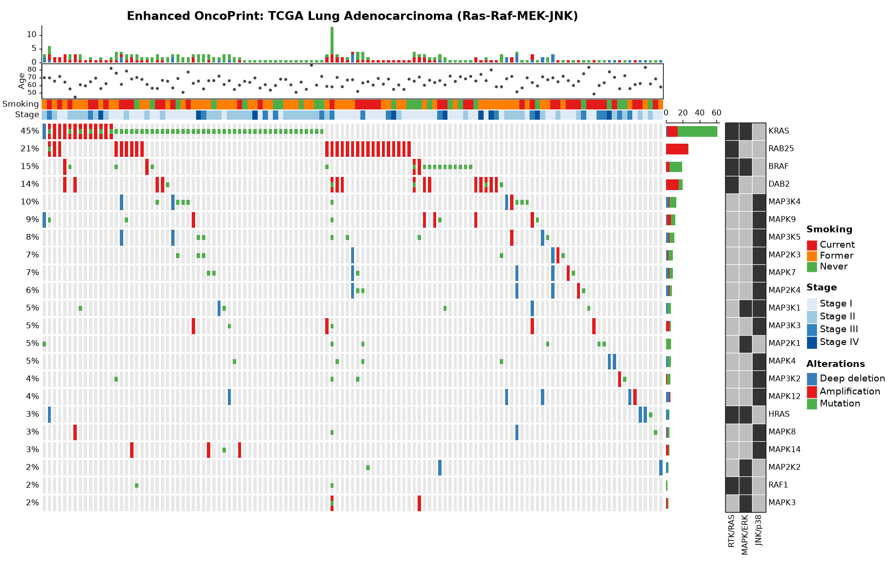

### 5. UpSet Plot

```python
cm = ch.make_comb_mat(sets)
cm = cm[:, ch.comb_size(cm) >= 3]
ch.UpSet(
    cm, comb_order=np.argsort(-ch.comb_size(cm), kind="stable"),
    comb_col=[deg_palette[d] for d in ch.comb_degree(cm)],
    top_annotation=ch.upset_top_annotation(cm, add_numbers=True),
    right_annotation=ch.upset_right_annotation(cm, add_numbers=True),
).draw()
```

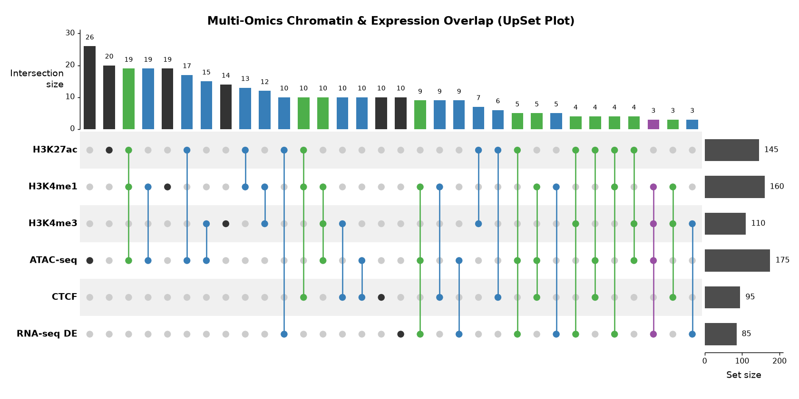

### 6. 3D Heatmap (`Heatmap3D`)

```python
ch.Heatmap3D(
    ch.load_dataset("measles").loc[top_states],
    col=ch.colorRamp2([0.0, 4000.0, 20000.0, 80000.0], ["#FFFFFF", "#FFEDA0", "#FEB24C", "#E31A1C"]),
    name="Cases", cluster_rows=False, cluster_columns=False,
    bar_angle=55.0, bar_max_length=ch.unit(12, "mm"),
).draw()
```

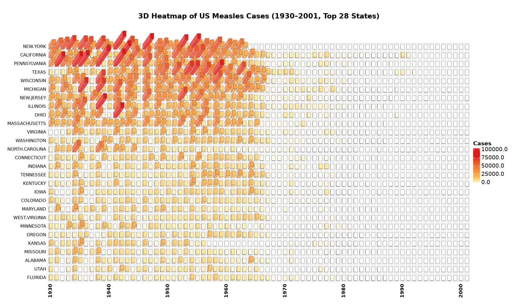

## Additional Feature Gallery

All figures below are generated directly by [`examples/showcase_gallery.py`](https://github.com/zhanxw/ComplexHeatmap-py/blob/main/examples/showcase_gallery.py).

### 1. Split Heatmap with Colored Dendrograms & Block Annotations

```python
dend_r = ch.color_branches(ch.hclust(ch.dist(mat)), k=2, col=["#E41A1C", "#377EB8"])
dend_c = ch.color_branches(ch.hclust(ch.dist(mat.T)), k=3, col=["#4DAF4A", "#984EA3", "#FF7F00"])
ht = ch.Heatmap(
    mat, name="Z-score",
    cluster_rows=dend_r, row_split=2,
    cluster_columns=dend_c, column_split=3,
    top_annotation=top_ha, left_annotation=left_ha, border=True,
)
ht.draw(save="02_single_heatmap_split.png")
```

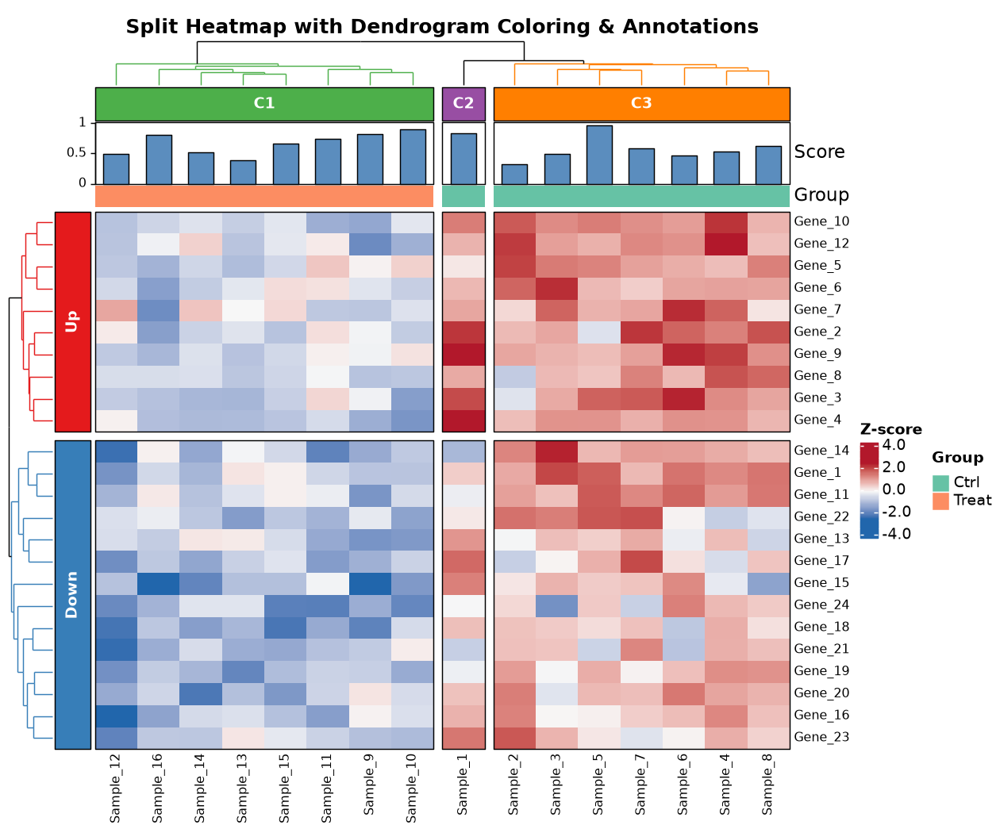

### 2. Multi-Track Annotations Zoo (`anno_points`, `anno_lines`, `anno_barplot`, `anno_boxplot`, `anno_density`, `anno_horizon`, `anno_mark`, `anno_textbox`)

```python
top_ha = ch.HeatmapAnnotation(
    Simple=list("AB" * 10),
    Points=ch.anno_points(pts),
    Lines=ch.anno_lines(line_vals, add_points=True),
    Bars=ch.anno_barplot(bar_vals),
    Boxplot=ch.anno_boxplot(box_mat),
)
right_ha = ch.rowAnnotation(
    Density=ch.anno_density(mat.to_numpy(), type="violin"),
    Horizon=ch.anno_horizon(horizon_series),
    Markers=ch.anno_mark(at=[2, 8, 15, 24, 33, 38], labels=["TP53", "KRAS", "EGFR", "MYC", "BRAF", "PTEN"]),
    Text=ch.anno_textbox(sp, pathways_dict),
)
ch.Heatmap(mat, row_split=sp, top_annotation=top_ha, right_annotation=right_ha).draw(...)
```

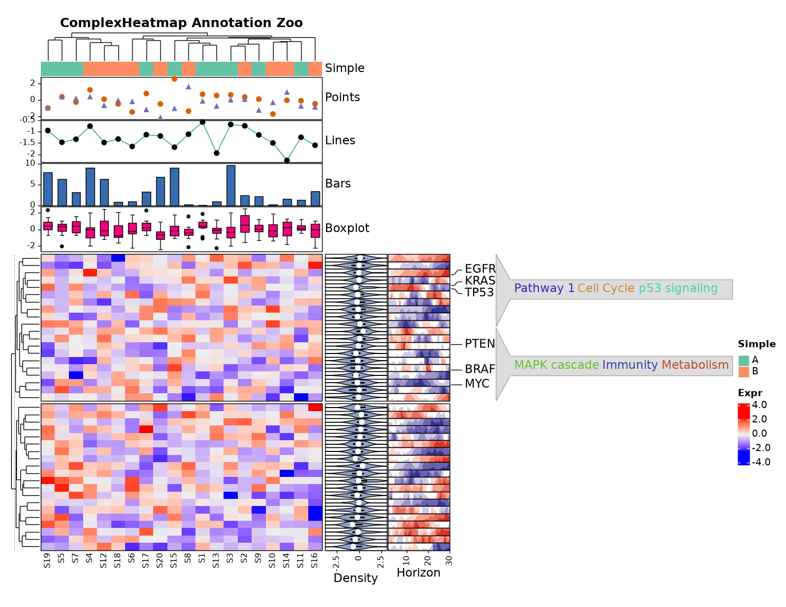

### 3. Measles Incidence Heatmap & Post-Draw Viewport Decoration

```python
mat = ch.load_dataset("measles")
ht = ch.Heatmap(mat, name="Cases", col=col_fun, cluster_rows=False, cluster_columns=False,
                top_annotation=ha_col, right_annotation=ha_row, border=True)
ht.draw(width=11.0, height=8.0, dpi=140)
with ch.decorate_heatmap_body("Cases"):
    ch.grid_segments(ch.unit(pos, "npc"), ch.unit(0, "npc"), ch.unit(pos, "npc"), ch.unit(1, "npc"),
                     gp=ch.gpar(lty="dashed", lwd=2))
    ch.grid_text("Vaccine (1961)", x=ch.unit(pos + 0.01, "npc"), y=ch.unit(0.96, "npc"), just=["left", "top"])
```

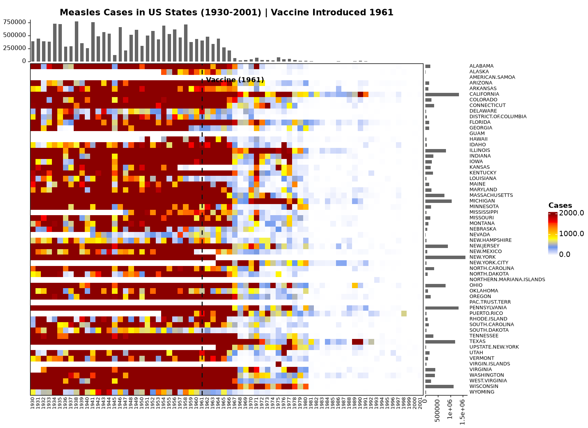

### 4. TCGA OncoPrint (`oncoPrint`)

```python
df = ch.load_dataset("tcga_lung_adenocarcinoma").iloc[:25, :60]
op = ch.oncoPrint(df, alter_fun=alter_fun, col=alt_col,
                  remove_empty_columns=True, remove_empty_rows=True)
op.draw(save="05_tcga_oncoprint.png")
```

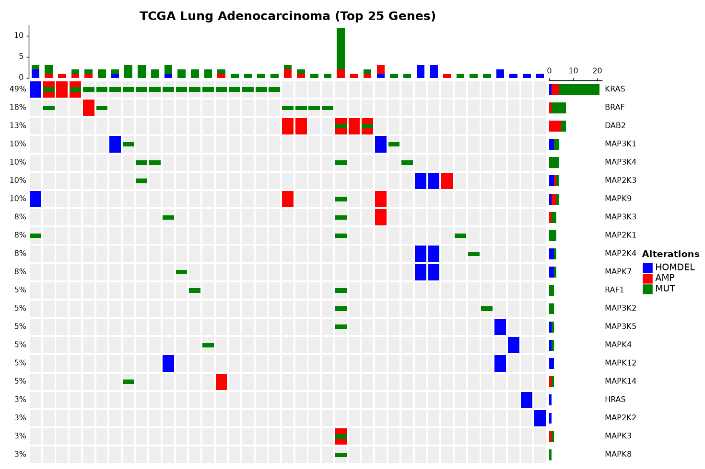

### 5. Multi-Omics UpSet Plot (`make_comb_mat` + `UpSet`)

```python
cm = ch.make_comb_mat(sets)
cm = cm[:, ch.comb_size(cm) >= 2]
up = ch.UpSet(
    cm,
    comb_col=["#E41A1C" if d >= 3 else ("#377EB8" if d == 2 else "#333333") for d in ch.comb_degree(cm)],
    top_annotation=ch.upset_top_annotation(cm, add_numbers=True),
    right_annotation=ch.upset_right_annotation(cm, add_numbers=True),
)
up.draw(save="06_upset_plot.png")
```

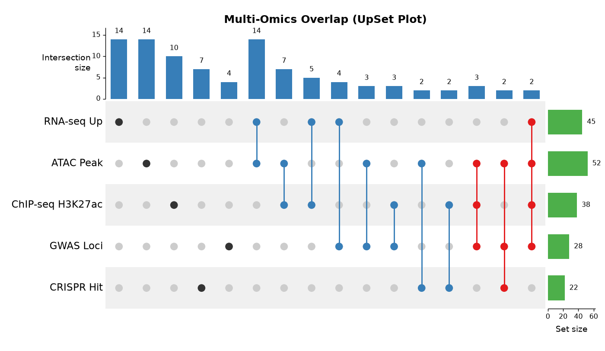

### 6. Integrated Multi-Heatmap List (`+` & `rowAnnotation`)

```python
hl = ht_meth + ht_expr + ch.rowAnnotation(Corr=ch.anno_points(corr_vals))
ch.draw(hl, column_title="Integrated Methylation & Gene Expression", merge_legends=True)
```

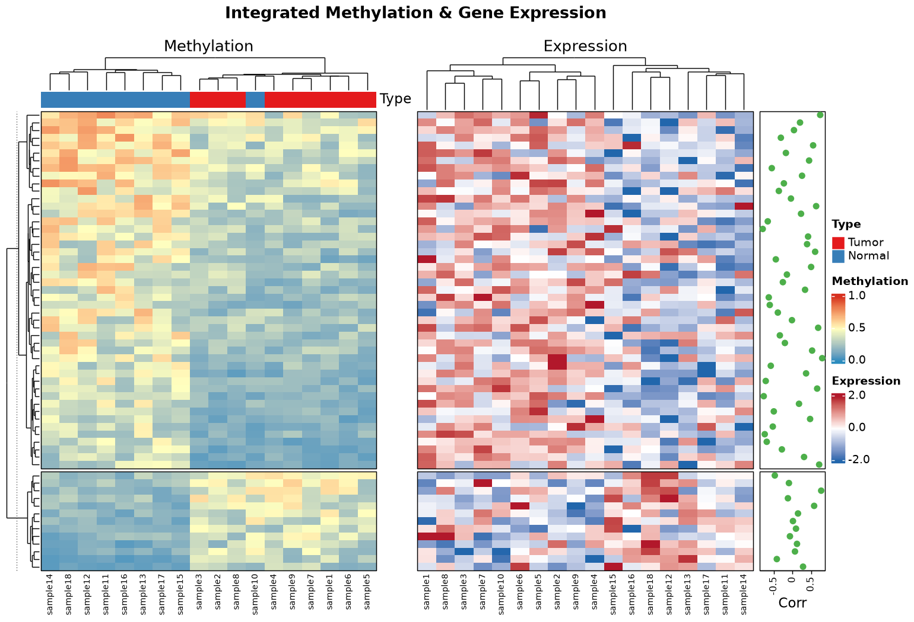

### 7. Density Heatmap & 3D Isometric Heatmap (`densityHeatmap`, `Heatmap3D`)

```python
ch.densityHeatmap(df_d, title="Distribution Density Across 10 Conditions", ylab="Signal").draw(...)
ch.Heatmap3D(mat_3d, name="Intensity", column_title="3D Isometric Heatmap (Heatmap3D)").draw(...)
```

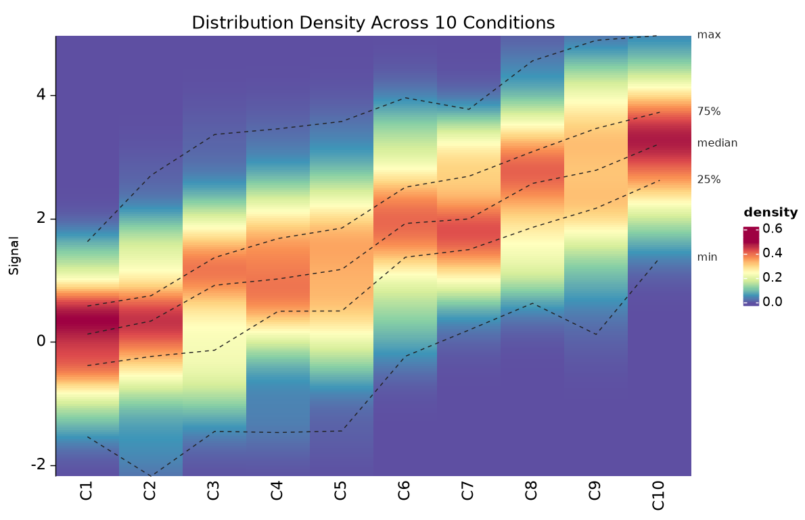
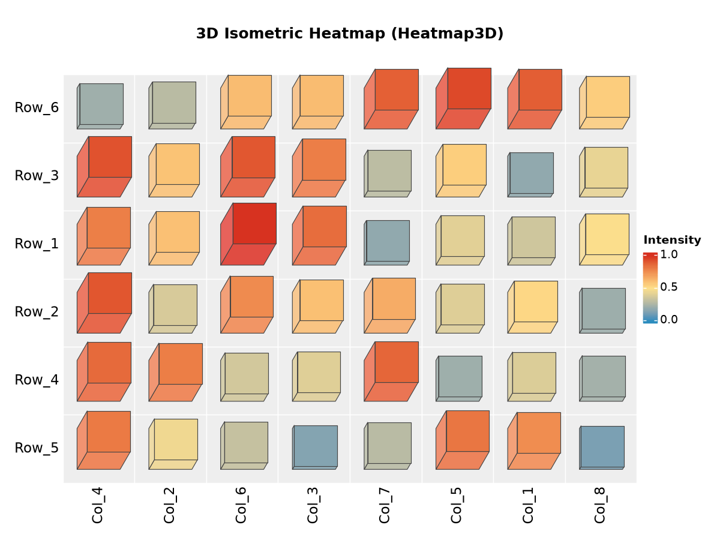

## Implemented Modules & Features

- **Core Graphics & Units (`units.py`, `grid.py`, `text.py`, `colors.py`)**: Vectorized `Unit` arithmetic (`mm`, `cm`, `inches`, `pt`, `npc`, `snpc`, `native`, `lines`, `char`, `grobwidth`/`grobheight`), `gpar`, nested Matplotlib viewports (`Viewport`, `pushViewport`, `popViewport`, `seekViewport`, `grid.*`), `ax=`/`SubFigure` composition, `to_svg()`, `GridText` (`gt_render` rich markup), `textbox_grob`, `smartAlign2`, and `colorRamp2` (LAB/XYZ/sRGB/HSV) + `ColorMapping`.
- **Clustering & Dendrograms (`dendrogram.py`)**: `dist`, `dist2`, `hclust` (including distinct `ward.D` and `ward.D2` + optional `fastcluster`), `Dendrogram`, `cut_dendrogram`, `adjust_dend_by_x`, `merge_dendrogram`, `color_branches`, `cluster_within_group`, `cluster_between_groups`, `grid_dendrogram`, Path A cutree & Path B slice-first + consensus k-means clustering.
- **Annotations (`annotations.py`, `anno_funcs.py`)**: All 21 `anno_*` (`anno_simple`, `anno_empty`, `anno_points`, `anno_lines`, `anno_barplot`, `anno_boxplot`, `anno_histogram`, `anno_density`, `anno_joyplot`, `anno_horizon`, `anno_text`, `anno_numeric`, `anno_mark`, `anno_zoom`, `anno_link`, `anno_block`, `anno_summary`, `anno_image`, `anno_customize`, `anno_textbox`, `anno_oncoprint_barplot`) + 6 `row_anno_*` aliases, `HeatmapAnnotation`, `rowAnnotation`, `columnAnnotation`, `SingleAnnotation`, `AnnotationFunction`, `attach_annotation`.
- **Multi-Heatmap Lists & Legends (`heatmap.py`, `heatmap_list.py`, `legend.py`, `decorate.py`)**: Horizontal (`+`) and vertical (`%v%` / `/`) concatenation, `auto_adjust`, `main_heatmap` alignment, `Legend`/`packLegend` discrete + continuous + unequal-break legends, legend deduplication/`c_ColorMapping`, all 11 `decorate_*` viewport decorators, and slice/subsetting indexing (`ht[i, j]`, `ht_list[i, j]`).
- **High-Level Genomics & Plots (`oncoprint.py`, `upset.py`, `density.py`, `three_d.py`, `genomic.py`, `translate.py`)**: `oncoPrint` (with memoSort & alteration polygons), `make_comb_mat` / `UpSet` (`distinct`, `intersect`, `union`, genomic intervals, `t(m)`), `densityHeatmap`, `frequencyHeatmap`, `ks_dist`, `bar3D`, `Heatmap3D`, `IRanges`/`GRanges`/`bin_genome`/`normalize_genomic_signals_to_bins`, and drop-in translations `pheatmap`, `heatmap`, `heatmap_2`, `compare_*`.
- **Examples & Verification**: Complete documentation in the **[ComplexHeatmap-py Complete Reference Book](https://zhanxw.github.io/ComplexHeatmap-reference-py/book/)**, upstream flagship README replications ([examples/r_readme_examples.py](https://github.com/zhanxw/ComplexHeatmap-py/blob/main/examples/r_readme_examples.py)), ports of all **102 executable `.Rd` examples** ([examples/run_all_rd_examples.py](https://github.com/zhanxw/ComplexHeatmap-py/blob/main/examples/run_all_rd_examples.py)), publication gallery ([examples/showcase_gallery.py](https://github.com/zhanxw/ComplexHeatmap-py/blob/main/examples/showcase_gallery.py)), R-to-Python guide ([examples/r_to_python_guide.md](https://github.com/zhanxw/ComplexHeatmap-py/blob/main/examples/r_to_python_guide.md)), and `pytest` suite (`137 passed`).

## License & Attribution

Released under the [MIT License](https://github.com/zhanxw/ComplexHeatmap-py/blob/main/LICENSE). Ported from the R/Bioconductor [ComplexHeatmap](https://github.com/jokergoo/ComplexHeatmap) package (v2.25.3), Copyright (c) 2020 Zuguang Gu (MIT License).
